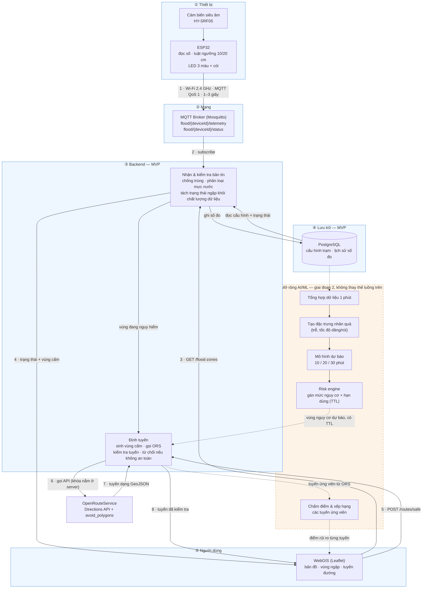
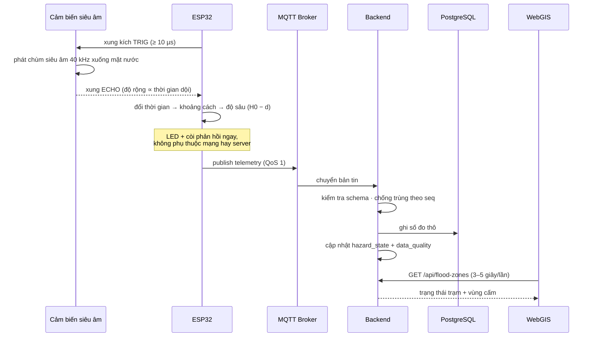
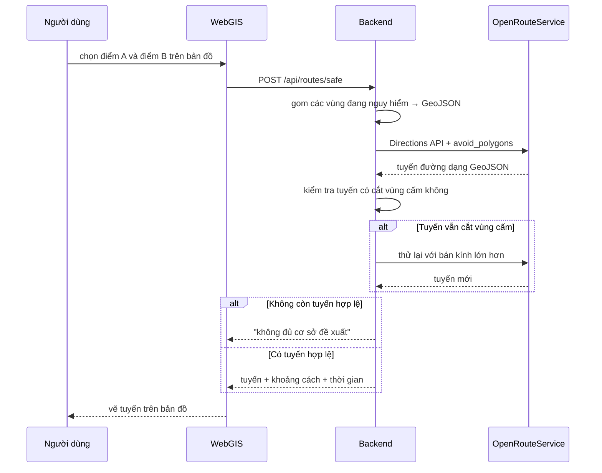

# Kiến trúc tổng quan — Hệ thống IoT cảnh báo ngập và đề xuất lộ trình

**Trạng thái:** bản nháp để cả nhóm thống nhất trước khi triển khai.
**Phạm vi:** kiến trúc mức hệ thống, không đi vào chi tiết code.
**Cách đọc sơ đồ:** nét liền = luồng MVP bắt buộc chạy được; nét đứt = phần mở rộng AI/ML ở giai đoạn sau; số trên mũi tên = thứ tự thực hiện.

---

## 1. Tóm tắt trong 30 giây

Trạm ESP32 đo mực nước bằng cảm biến siêu âm và cảnh báo tại chỗ bằng đèn/còi. Số đo được gửi qua **MQTT** về một máy chủ chạy trên laptop. Máy chủ phân loại mực nước thành ba mức, lưu lịch sử, và khi có điểm ngập nguy hiểm thì sinh một vùng cấm hình tròn quanh điểm đó. Người dùng mở bản đồ web, chọn điểm đi và điểm đến; máy chủ gọi **OpenRouteService** với tham số `avoid_polygons` để lấy tuyến đường vòng tránh vùng ngập, rồi trả về cho bản đồ vẽ.

Điểm mở rộng: sau khi luồng trên chạy ổn định, bổ sung một nhánh **AI/ML** dự báo mực nước trước 10–30 phút và dùng dự báo đó để chấm điểm, xếp hạng các tuyến ứng viên.

---

## 2. Sơ đồ tổng quan

**Ghi chú đọc sơ đồ:**

- Cụm ③ là **một backend duy nhất**, gồm hai module: `B` (nhận & kiểm tra bản tin) và `R` (định tuyến). Mũi tên `B → R` là lời gọi nội bộ trong cùng tiến trình, không phải một chặng mạng.
- Cụm ④ là cơ sở dữ liệu — **tiến trình riêng, không nằm trong backend**. Hai mũi tên qua lại `B ↔ DB` là kết nối mạng tới PostgreSQL, không phải lời gọi hàm.
- Mũi tên nét đứt `A4 → R` nghĩa là: mô hình dự báo sinh ra **vùng nguy cơ dự báo** (kèm hạn dùng), và module định tuyến dùng vùng đó giống như vùng ngập hiện tại — chỉ khác là có gắn nhãn "dự báo" và tự hết hiệu lực sau một khoảng thời gian. Nhờ vậy tuyến đường có thể né cả chỗ **sắp** ngập, không chỉ chỗ đang ngập.
- Mũi tên nét đứt `R → A5 → F` là bước chấm điểm: sau khi ORS trả về các tuyến ứng viên, module chấm điểm xếp hạng chúng theo rủi ro rồi mới gửi kết quả cho giao diện.

### 2.1. Luồng thu nhận dữ liệu (MVP)

### 2.2. Luồng đề xuất lộ trình (MVP)

---

## 3. Thành phần và công nghệ

| Lớp | Thành phần | Vai trò | Công nghệ đề xuất |
|---|---|---|---|
| Thiết bị | Nút cảm biến | Đo mực nước, cảnh báo tại chỗ, gửi dữ liệu | ESP32 + HY-SRF05 + LED/buzzer |
| Mạng | MQTT Broker | Trung chuyển bản tin theo topic | Eclipse Mosquitto |
| Máy chủ | Backend | Nhận dữ liệu, phân loại, sinh vùng cấm, gọi định tuyến | Spring Boot *hoặc* FastAPI |
| Lưu trữ | Cơ sở dữ liệu | Lưu cấu hình trạm và lịch sử đo | PostgreSQL (bật PostGIS ở giai đoạn 2) |
| Bản đồ | Dịch vụ định tuyến | Tính tuyến tránh vùng cấm | OpenRouteService |
| Giao diện | WebGIS | Hiển thị bản đồ, vùng ngập, tuyến đường | Leaflet (Vite + React hoặc Next.js) |

Toàn bộ máy chủ, cơ sở dữ liệu và giao diện chạy trên **một laptop** trong cùng mạng Wi-Fi với trạm. Không cần thuê VPS cho MVP.

---

## 4. Ba luồng chạy chính của MVP

**Luồng A — Thu nhận dữ liệu (1–3 giây/lần)**

1. ESP32 đọc khoảng cách từ cảm biến, quy đổi ra độ sâu mực nước.
2. Áp luật ngưỡng tại chỗ: dưới 10 cm xanh, 10–20 cm vàng, trên 20 cm đỏ + còi.
3. Gửi bản tin JSON qua MQTT, kèm mã thiết bị, số thứ tự và thời điểm đo.
4. Backend kiểm tra trùng lặp, lưu số đo, cập nhật trạng thái khu vực.

**Luồng B — Hiển thị (giao diện hỏi lại mỗi 3–5 giây)**

1. Giao diện gọi API lấy danh sách trạm và trạng thái hiện tại.
2. Marker đổi màu theo mức ngập; trạm mất kết nối hiển thị **xám**, không phải xanh.
3. Khi có mức nguy hiểm, vẽ vòng tròn vùng cấm bán kính khoảng 40 m quanh điểm đo.

**Luồng C — Đề xuất lộ trình (chỉ chạy khi người dùng bấm tìm đường)**

1. Người dùng click chọn điểm đi và điểm đến trên bản đồ.
2. Backend gom tất cả vùng đang nguy hiểm, chuyển thành đa giác GeoJSON.
3. Gọi OpenRouteService kèm tham số `avoid_polygons`.
4. Kiểm tra tuyến trả về có thật sự né vùng cấm không; nếu chưa thì thử lại với bán kính lớn hơn.
5. Nếu không còn tuyến nào hợp lệ, trả về thông báo **không đủ cơ sở đề xuất** — tuyệt đối không trả lại tuyến mặc định.
6. Giao diện vẽ tuyến, kèm khoảng cách, thời gian và số điểm ngập đã né.

---

## 5. Nguyên tắc thiết kế

1. **MQTT là bắt buộc trong MVP**, không phải tùy chọn. Bài báo lấy MQTT làm kiến trúc truyền thông và có số liệu độ trễ đo trên nó.
2. **Thiết bị không biết gì về bản đồ.** Nó chỉ đo và gửi; mọi quyết định định tuyến nằm ở máy chủ.
3. **Máy chủ giữ khóa API định tuyến.** Không bao giờ để khóa trong mã JavaScript của trình duyệt.
4. **Mất dữ liệu khác với hết ngập.** Trạm mất kết nối phải hiển thị "không rõ", không được hiển thị "an toàn".
5. **Thà từ chối còn hơn đề xuất sai.** Không có tuyến an toàn thì nói rõ, không hạ ngưỡng ngầm.
6. **Gọi định tuyến theo yêu cầu, không theo polling.** Mỗi bản tin cảm biến không được kéo theo một lần gọi API bản đồ.
7. **AI là phần bổ sung, không phải xương sống.** Khi mô hình lỗi hoặc thiếu dữ liệu, hệ thống quay về luật ngưỡng và vẫn phải đúng.

---

## 6. Giai đoạn 2 — AI/ML nối vào đâu

Nhánh AI **không thay thế** luồng nào ở trên; nó đọc dữ liệu đã lưu, chạy nền, và trả thêm một loại vùng nguy cơ.

| Hạng mục | Nội dung | Nối vào điểm nào |
|---|---|---|
| Dự báo độ sâu | Dự báo mực nước tại điểm đo trước 10/20/30 phút | Đọc từ bảng lịch sử, ghi ra bảng dự báo |
| Kiểm soát chất lượng | Luật phát hiện cảm biến lỗi, mất mẫu, giá trị bất thường | Gắn cờ vào bản ghi, hiển thị ở giao diện |
| Vùng nguy cơ dự báo | Sinh vùng cấm từ dự báo, có thời hạn hiệu lực | Đưa vào cùng chỗ sinh vùng cấm của luồng C |
| Xếp hạng tuyến | Chấm điểm các tuyến ứng viên theo rủi ro và mức đi vòng | Sau khi ORS trả về nhiều tuyến |
| Thời tiết | Mưa quá khứ / dự báo mưa làm đặc trưng bổ sung | Chỉ thêm khi đo được là có đóng góp |

Nguyên tắc bắt buộc khi thêm AI:

- **Hai luồng độc lập:** cảnh báo theo số đo thật chạy ngay; dự báo chạy riêng, không được làm chậm cảnh báo.
- **Dự báo không được hạ cảnh báo đỏ** đã đo được.
- **Mọi dự báo phải có thời điểm phát hành và hạn dùng**; hết hạn thì không dùng để tính tuyến.
- **Không gọi tuyến đề xuất là "an toàn tuyệt đối"** — chỉ là "ít rủi ro hơn theo dữ liệu hiện có".

---

## 7. So sánh phạm vi hai giai đoạn

| Hạng mục | MVP | Giai đoạn 2 |
|---|---|---|
| Số trạm | 1 trạm thật + dữ liệu mô phỏng | 2–3 trạm có đối soát thước đo |
| Bảo mật MQTT | Mạng LAN, chưa mã hóa | TLS + tài khoản riêng từng thiết bị |
| Cơ sở dữ liệu | PostgreSQL, lưu số đo thô | Thêm PostGIS và bảng tổng hợp 1 phút |
| Định tuyến | Tránh cứng một vùng cấm | Nhiều ứng viên + chấm điểm rủi ro |
| Cảnh báo | Theo ngưỡng hiện tại | Thêm dự báo trước 10–30 phút |
| Học máy | Không có | XGBoost; LSTM/camera chỉ khi đủ dữ liệu |
| Giao diện | Marker, vùng ngập, tuyến đường | Thêm biểu đồ lịch sử và dự báo |

---

## 8. Lưu ý khi báo cáo và demo

- Kết quả định tuyến chỉ là **giảm mức phơi nhiễm trong kịch bản mô phỏng**, không phải chứng nhận tuyến đường an toàn ngoài thực tế.
- Bán kính vùng cấm (30–50 m) là **cấu hình thử nghiệm**, chưa phải phạm vi ngập thực của cả đoạn đường. Một điểm đo không đại diện cho cả con phố.
- Không đưa số liệu độ trễ hoặc độ chính xác vào báo cáo nếu chưa đo lại trên hệ thống thật.
- Không đưa dữ liệu thô từ các bộ dữ liệu quốc tế lên kho mã nguồn chung nếu giấy phép không cho phép tái phân phối.
