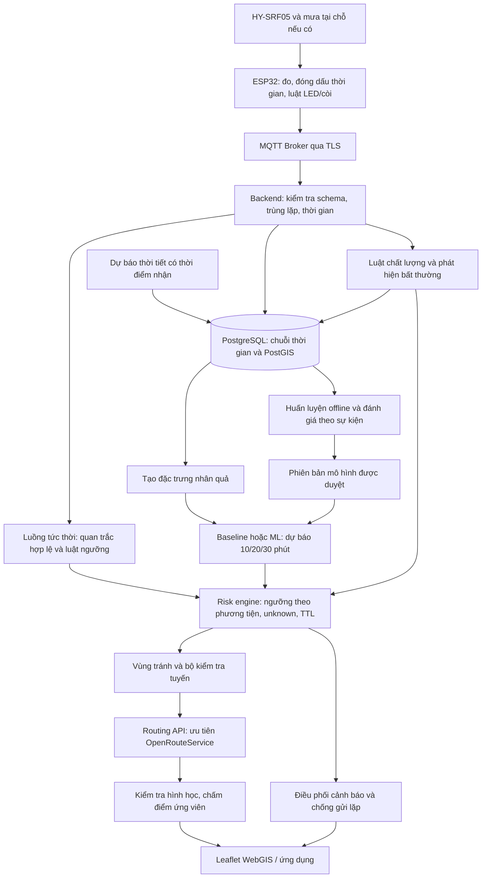

# Nghiên cứu tích hợp AI/ML cho hệ thống IoT cảnh báo ngập và đề xuất lộ trình thích ứng

**Ngày tra cứu:** 31/10/2026, theo ngày của môi trường làm việc.
**Phạm vi:** nghiên cứu, thiết kế và kế hoạch thực nghiệm cho đồ án; không triển khai mã sản phẩm, không sửa tài liệu Word.
**Tài liệu nền:** “Hệ thống IoT cảnh báo ngập lụt và đề xuất lộ trình (Phương án Map API).docx”, đã đọc nội dung XML trong tệp DOCX. [G0]

> **Khuyến nghị:** giữ ESP32 + MQTT + Leaflet + OpenRouteService; bổ sung dự báo độ sâu ngập tại điểm đo trước 10–30 phút, kiểm soát chất lượng cảm biến và lựa chọn tuyến có mức phơi nhiễm ngập thấp hơn. Không bắt đầu bằng LSTM, camera hay mô hình ngập toàn thành phố. Không gọi tuyến được đề xuất là “tuyến an toàn tuyệt đối”.

## 1. Cách đọc báo cáo và giới hạn chứng cứ

- **Thông tin nguồn:** các nhận định về API, thư viện, tiêu chuẩn và bài báo có liên kết nguồn sơ cấp ngay tại nội dung tương ứng.
- **Đề xuất của báo cáo:** lựa chọn kiến trúc, thông số thử nghiệm, công thức chấm điểm, lịch thực hiện và tiêu chí quyết định là thiết kế đề nghị, chưa phải kết quả đã chứng minh.
- Các con số 10/20/30 phút, chu kỳ tổng hợp một phút, quy mô trạm và mục tiêu độ trễ bên dưới là cấu hình nghiên cứu dự kiến, không phải cam kết hiệu quả.
- Đã tra cứu bằng tìm kiếm và đọc trực tiếp tài liệu chính chủ; không sử dụng bài tổng hợp của bên thứ ba làm bằng chứng kỹ thuật.
- “Truy cập ngày 31/10/2026” không có nghĩa nguồn được xuất bản ngày đó; những trang `stable`/`latest` có thể đổi nội dung sau lần đọc này.
- Chưa gọi API định tuyến bằng khóa của nhóm, chưa có dữ liệu đo thô, chưa thực nghiệm với phương tiện hay xác nhận hiện trường.

## 2. Phương án gốc và những điểm phải làm rõ

### 2.1. Những thành phần nên giữ

1. Trạm dùng cảm biến siêu âm HY-SRF05 đo khoảng cách tới mặt nước, suy ra độ sâu theo mốc lắp đặt: `d = H_0 - H_measure`; đèn ba màu và còi cảnh báo tại chỗ. [G0]
2. Thiết bị gửi JSON qua MQTT với chu kỳ nêu trong tài liệu là 1–3 giây; ứng dụng hiển thị WebGIS bằng Leaflet. [G0]
3. Phương án bản đồ được nêu là **OpenRouteService/Mapbox**, không phải Google Maps; phần quy trình thực nghiệm chỉ rõ OpenRouteService Directions API. [G0]
4. Khi ngập vượt ngưỡng, phương án gốc tạo đa giác tránh quanh điểm đo, bán kính thử nghiệm khoảng 30–50 m, rồi yêu cầu tính lại tuyến. [G0]
5. Ngưỡng đang dùng là Safe dưới 10 cm, Caution 10–20 cm và Unsafe trên 20 cm. Đây là quy ước của tài liệu gốc, chưa phải tiêu chuẩn đi qua nước ngập cho mọi phương tiện. [G0]

### 2.2. Không kế thừa nguyên trạng các khẳng định sau

- Tài liệu dùng lẫn **ESP32 và ESP8266**; cần chốt thiết bị thực tế trước khi lập BOM, sơ đồ điện và giao thức dữ liệu. [G0]
- Tài liệu tự báo cáo sai số dưới 1,5 cm, MQTT 150–300 ms, API 250–450 ms và tổng thời gian dưới 1,5 giây; hiện chưa có log, số lần lặp hay điều kiện đo để kiểm chứng độc lập. [G0]
- Không coi OpenRouteService và Mapbox là hai API thay thế ngang nhau cho `avoid_polygons`; giao diện được công bố của chúng khác nhau, xem mục 7. [S01], [S03]
- Bán kính vòng tròn không chứng minh phạm vi ngập thực: một điểm đo không xác nhận tình trạng của cả con phố, đường song song, cầu vượt hoặc hầm chui. Đây là giới hạn suy luận của thiết kế gốc.
- Đề xuất đổi cách diễn đạt trên giao diện thành **“ít rủi ro hơn theo dữ liệu hiện có”**, kèm thời điểm cập nhật và phần tuyến chưa được quan trắc.
- NWS khuyến cáo không lái xe hoặc đi bộ vào nước lũ và không vòng qua rào chắn; độ sâu quan trắc thấp không được dùng làm bảo đảm có thể đi qua. [S24]

## 3. Bốn hướng AI/ML và mức ưu tiên

| Hướng | Đầu vào chính | Đầu ra và giá trị bổ sung | Ưu tiên |
| --- | --- | --- | --- |
| A. Dự báo độ sâu/nguy cơ vượt ngưỡng | Lịch sử mực nước; mưa tại chỗ nếu có; dự báo mưa đã nhận | Độ sâu tại `t+10/20/30 phút`, cảnh báo trước khi vượt ngưỡng | Trọng tâm học thuật |
| B. Phát hiện cảm biến bất thường | Khoảng cách thô, xu hướng, thiếu mẫu, trạng thái thiết bị | Cờ nghi lỗi, mất kết nối, giảm tin cậy; không xóa cảnh báo ngập thật | Bắt buộc ở mức luật; ML bổ sung |
| C. Xếp hạng đoạn đường và điều hướng dự báo | A + B, ánh xạ trạm–đường, tuyến từ API | Vùng cần tránh và tuyến ứng viên ít phơi nhiễm hơn | Trọng tâm ứng dụng |
| D. Thị giác máy tính/hợp nhất đa nguồn | Camera cố định, thước chuẩn, dữ liệu trạm | Xác nhận nước xuất hiện hoặc bổ sung quan sát tại ROI | Chỉ mở rộng khi A–C ổn định |

### 3.1. A — Dự báo ngắn hạn tại điểm đo

**Đề xuất:** bắt đầu với từng điểm ngập hoặc một cụm trạm thuộc khu vực nhỏ đã khảo sát, không tuyên bố dự báo ngập cho toàn đô thị.
- Dự báo hồi quy độ sâu bằng dữ liệu trễ, tốc độ dâng/rút và thống kê cửa sổ; huấn luyện riêng cho từng chân trời 10, 20, 30 phút để dễ đối chiếu.
- MVP có thể chỉ hiển thị dự báo độ sâu rồi áp quy tắc cảnh báo; khi đủ sự kiện dương/âm mới thêm bộ phân loại xác suất vượt ngưỡng.
- Phân biệt “độ sâu ở phút thứ 30” và “có vượt ngưỡng trong bất kỳ lúc nào trong 30 phút tới”; hai nhãn này không tương đương.
- Xuất cả độ mới dữ liệu, chế độ mô hình/baseline và cảnh báo thiếu dữ liệu; có thể thêm phân vị khi đủ dữ liệu đánh giá khoảng dự báo.
- XGBoost có mục tiêu hồi quy bình phương, phân loại logistic và hồi quy phân vị `reg:quantileerror`; đây là khả năng thư viện, không phải bằng chứng độ chính xác cho điểm ngập của nhóm. [S07]

### 3.2. B — Kiểm soát bất thường cảm biến

**Đề xuất hai tầng:** luật kiểm tra rõ ràng trước, Isolation Forest sau nếu có lợi ích đo được.
- Luật: mất echo, giá trị ngoài miền hiệu chuẩn, đồng hồ sai, chuỗi giá trị đứng yên bất thường, thiếu bản tin, nhảy giá trị cần kiểm tra.
- Đặc trưng ML: biến thiên khoảng cách, độ phân tán trong cửa sổ, thời gian từ mẫu hợp lệ cuối cùng, điện áp/RSSI nếu đo được và sai khác với trạm liên quan đã xác minh.
- Isolation Forest trả điểm bất thường bằng cơ chế cô lập mẫu; `contamination` tham gia đặt ngưỡng điểm, không phải xác suất xảy ra ngập. [S10]
- Không chỉ huấn luyện trên ngày khô rồi coi mọi nước dâng nhanh là lỗi; phải có tập vận hành hợp lệ gồm cả mưa/ngập và tập lỗi có gán nhãn để kiểm tra.
- “Hiếm” không đồng nghĩa “hỏng”: khi mực nước tăng mạnh nhưng chưa xác minh nguyên nhân, giữ cảnh báo nghi ngập, đánh dấu chất lượng và yêu cầu đối soát.
- Luôn lưu mẫu thô và lý do gắn cờ; không âm thầm làm trơn hoặc thay bằng số 0 rồi cho đường trở lại trạng thái xanh.

### 3.3. C — Rủi ro đoạn đường và tái định tuyến

**Đề xuất:** biến dự báo tại trạm thành trạng thái cho những đoạn đường có quan hệ đã khảo sát, sau đó dùng API để tính tuyến tránh vùng nguy cơ.
- Tách `hazard_state` (mức ngập/nguy cơ) khỏi `data_quality` (tin cậy, thiếu, cũ); một đường không có dữ liệu không mặc nhiên là đường khô.
- Cho phép so sánh theo loại phương tiện qua bộ ngưỡng nghiên cứu `T_v`, nhưng không suy từ kích thước/gầm xe thành giấy phép đi qua nước.
- MVP dùng tránh cứng những đoạn/nguy cơ đã vượt chính sách và chấm điểm các tuyến ứng viên còn lại; không cần mạng học sâu để chọn tuyến.
- Phần AI nằm ở dự báo/ước lượng nguy cơ; phép giao hình học, luật đóng đoạn và thuật toán tìm đường không tự nhiên trở thành “AI”.
- Khi tuyến dài hơn chân trời dự báo 30 phút, phần nằm ngoài phạm vi phải ghi “chưa có dự báo”; không kéo dài giá trị cuối như một bảo đảm.

### 3.4. D — Camera và hợp nhất nguồn, tùy chọn

**Đề xuất nghiên cứu tiếp:** một camera cố định nhìn vùng mặt đường/thước chuẩn; thử phân loại có/không có nước hoặc phân đoạn vùng nước, đối chiếu với nhãn thủ công.
- Không bắt đầu bằng bài toán “YOLO nhìn ảnh bất kỳ và suy ra chính xác độ sâu”: cần hình học camera, mốc chuẩn, nhãn độ sâu đồng thời và kiểm định riêng.
- Chia dữ liệu theo ngày/sự kiện/camera; ảnh liên tiếp của cùng đợt mưa không được nằm lẫn train và test.
- Kiểm thử phản quang, bóng xe, che khuất, ban đêm, nước bẩn và giọt mưa trên kính; không có ảnh hợp lệ thì nguồn này là thiếu.
- Chỉ hợp nhất sau khi đo sai số từng nguồn; bất đồng camera–siêu âm tạo yêu cầu xác minh, không lấy trung bình vô điều kiện.
- Giới hạn ROI để tránh thu mặt người/biển số; đề nghị xử lý tại biên và chỉ lưu kết quả nếu không cần ảnh cho nhãn.

## 4. Phạm vi MVP khả thi cho đồ án

**Đề xuất chốt:** 1–3 trạm tại các vị trí được phép lắp, một khu vực đường nhỏ, một backend và một WebGIS; nếu chỉ có một trạm, giới hạn kết luận đúng tại điểm đó.
1. Ghi nhận và phát lại dữ liệu thô có thời gian, hiệu chuẩn mốc đo, cảnh báo ngưỡng tại chỗ hoạt động không cần ML.
2. Có baseline persistence và ngoại suy xu hướng; so sánh thêm **một** thư viện boosting, ưu tiên XGBoost, thay vì cùng lúc tối ưu nhiều họ mô hình.
3. Dự báo tại ba chân trời; hiển thị quan trắc và dự báo bằng kiểu vẽ khác nhau, không tô dự báo thành “sự thật hiện trường”.
4. Luật chất lượng cảm biến, mất mạng, hết hạn dữ liệu và cơ chế không đưa ra khuyến nghị khi thiếu bằng chứng.
5. Leaflet hiển thị vùng quan trắc, vùng cần tránh và tuyến từ OpenRouteService; nhận cảnh báo sớm theo thay đổi trạng thái.
6. Bộ mô phỏng/phát lại đánh giá quy trình cảnh báo–tái định tuyến; chưa cần camera, LoRaWAN, app native hay trợ lý ngôn ngữ.

**Điều kiện nâng cấp:** chỉ đưa ML vào vận hành khi đánh giá trên sự kiện giữ lại cho thấy lợi ích so với baseline và không làm tăng bỏ sót vượt mức chấp nhận đã thống nhất.
**Nếu không đủ dữ liệu mưa/ngập:** vẫn hoàn thành hệ đo, kiểm soát chất lượng và demo dự báo trong phòng thí nghiệm; đổi phạm vi kết luận, không tạo số liệu hiện trường giả.

## 5. Dữ liệu cần thu và cách tạo nhãn

### 5.1. Hợp đồng dữ liệu đề xuất

| Nhóm | Trường/đơn vị | Yêu cầu |
| --- | --- | --- |
| Định danh | `station_id`, `device_id`, `boot_id`, `seq` | Phân biệt trạm, lần khởi động và bản tin gửi lại |
| Thời gian đo | `observed_at` UTC, ISO 8601 có `Z`, tới mili giây nếu có | Thời điểm lấy mẫu; kèm trạng thái đồng bộ đồng hồ |
| Thời gian nhận | `received_at`, `available_at` UTC | Nhận tại server và lúc sẵn sàng cho quyết định; phục vụ phát lại đúng thời điểm |
| Đo thô | `distance_cm`, cờ echo hợp lệ | Không biến lỗi đo thành khoảng cách hoặc độ sâu bằng 0 |
| Hiệu chuẩn | `H0_cm`, `calibration_version`, ngày khảo sát | Mốc tới mặt đường, không phải độ cao địa hình từ API |
| Độ sâu | `depth_raw_cm`, `depth_cm`, `quality_flag` | Giữ hiệu số có dấu; chỉ giới hạn giá trị hiển thị sau kiểm tra chất lượng |
| Mưa tại chỗ, nếu bổ sung | `rain_increment_mm`, `interval_start/end`; cường độ `mm/h` | Phân biệt lượng trong khoảng với tốc độ; cần dụng cụ đo lượng mưa được hiệu chuẩn |
| Thiết bị, nếu có | `battery_v`, `rssi_dbm`, uptime giây, firmware | Phục vụ chẩn đoán; không tự giả định phần cứng đang có những phép đo này |
| Không gian | Tọa độ WGS84, `road_segment_id`, làn/cao độ tương đối | Ánh xạ khảo sát, không chỉ chọn đoạn gần nhất |
| Thời tiết dự báo | Nhà cung cấp, model/run, thời gian nhận, thời gian hiệu lực, lượng mưa `mm` theo khoảng | Lưu phản hồi gốc hoặc bản chuẩn hóa có truy vết |
| Nhãn đối soát | Độ sâu thước chuẩn `cm`, thời gian, người ghi, sự kiện, bằng chứng | Nguồn kiểm định độc lập với kết quả ML |
| Quyết định | Ngưỡng/phiên bản chính sách, phiên bản mô hình, tuyến, thời điểm, lý do | Cho phép tái lập vì sao cảnh báo hoặc từ chối đề xuất |

**Đề xuất xử lý:** giữ dữ liệu 1–3 giây của thiết kế gốc; tạo bảng một phút cho mô hình bằng cửa sổ kết thúc tại `t`, lưu median/max/tỷ lệ mẫu hợp lệ, không lấy dữ liệu sau `t`. [G0]
Không cần gọi Map API theo từng bản tin; tách nhịp đo, nhịp dự báo một phút và sự kiện đổi trạng thái định tuyến.
Sửa mốc lắp đặt phải tăng phiên bản hiệu chuẩn; không ghép các thời kỳ khác mốc như cùng một chuỗi độ sâu.

### 5.2. Nhãn dự báo và ngưỡng phương tiện

- **Hồi quy:** `y_h(t) = depth(t+h)`, với `h ∈ {10,20,30 phút}`; quy định cách chọn mẫu hợp lệ quanh thời điểm đích trước khi đánh giá.
- Chốt rõ `depth` là phép đo đã kiểm định hay thống kê một phút nào; nếu dự báo median thì không dùng max làm đích đánh giá mà không đổi tên bài toán.
- **Sự kiện:** `z_h,v(t) = 1` nếu có độ sâu hợp lệ vượt `T_v` trong khoảng `(t,t+h]`; chỉ gán nhãn âm khi cửa sổ đủ quan sát, nếu không để nhãn thiếu.
- Có thể yêu cầu vượt ngưỡng đủ số mẫu/thời gian để tránh nhiễu; quy tắc xác nhận phải công bố vì nó làm thay đổi thời điểm bắt đầu và lead time.
- Tách “đang ngập” khỏi “sắp bắt đầu ngập”: đánh giá cảnh báo trước khởi phát chỉ trên các thời điểm chưa vượt ngưỡng.
- Ngưỡng 10/20 cm của bản gốc chỉ dùng để so sánh baseline/kiểm thử; chốt rõ trường hợp bằng ngưỡng và không đổi định nghĩa giữa các thực nghiệm. [G0]
- `T_v` là tham số chính sách theo phương tiện và bối cảnh, cần tham vấn/khảo sát; báo cáo này không xác lập mức nước có thể đi qua an toàn.
- Lưu yếu tố chưa đo như dòng chảy, hố ga, mặt đường và rào chắn ở trạng thái không biết; khuyến cáo của NWS không cho phép suy “dưới ngưỡng tức là an toàn”. [S24]
- Nhãn đo tương lai từ cùng cảm biến chỉ chứng minh khả năng dự báo chuỗi cảm biến; muốn kết luận độ sâu thực phải có đối soát bằng dụng cụ độc lập.

### 5.3. Thời tiết: dùng đúng dữ liệu đã biết tại thời điểm dự báo

Open-Meteo Forecast API cung cấp đầu ra mô hình thời tiết, không phải trạm đo ngay tại mặt đường; `precipitation` hourly là tổng lượng của giờ trước, đơn vị mặc định mm. [S14]
Tài liệu nêu dữ liệu 15 phút ngoài các vùng mô hình được hỗ trợ có thể được nội suy từ dữ liệu một giờ; không coi chuỗi 15 phút tại Việt Nam là quan trắc mưa cục bộ 15 phút. [S14]
**Đề xuất:** MVP ưu tiên lịch sử mực nước và mưa tại chỗ nếu thu được; Open-Meteo chỉ là đặc trưng bổ sung cần kiểm tra mức đóng góp.
- Dự báo 30 phút **không bắt buộc** phải biết mưa thực trong 30 phút tương lai; mô hình có thể dùng lịch sử, nhưng khả năng dự báo mưa mới xuất hiện phải được kiểm nghiệm.
- Nếu dùng mưa tương lai làm đầu vào, phải là **bản dự báo đã nhận trước thời điểm `t`**, không phải mưa quan trắc/tái phân tích tải về sau sự kiện.
- Historical Forecast API ghép các giờ đầu của nhiều model run thành chuỗi liên tục; bản thân chuỗi này không tái tạo đầy đủ mọi dự báo đã có tại một giờ quyết định trong quá khứ. [S15]
- Single Runs API giữ từng run; `run` là giờ khởi tạo, không phải giờ công bố. Phải kiểm tra độ trễ phát hành và chỉ sử dụng run thực sự đã khả dụng lúc quyết định. [S16]
- Tài liệu Single Runs hiện nêu phần lớn mô hình có kho từ 02/04/2026, ECMWF IFS có lịch sử riêng từ 03/2024; vẫn phải kiểm tra model, biến và khoảng ngày cụ thể trước tải dữ liệu. [S16]
- Ưu tiên tự lưu phản hồi dự báo từ ngày đầu thí nghiệm; nếu không chứng minh được tính khả dụng lịch sử, loại đặc trưng đó khỏi backtest vận hành, hoặc ghi rõ chỉ là thử nghiệm “biết trước thời tiết”.

### 5.4. Nguồn địa phương và giới hạn dữ liệu địa hình
Nếu pilot tại Hà Nội, có thể **liên hệ xin** dữ liệu lịch sử mưa/ngập từ Công ty Thoát nước Hà Nội: website có bản đồ giám sát điểm úng ngập và trang chính sách xác nhận đơn vị sở hữu HSDC Maps, kèm thông tin liên hệ. Chưa xác minh API công khai, khả năng cung cấp lịch sử hay giấy phép huấn luyện; không mặc định nhóm có quyền tải hoặc dùng dữ liệu đó. [S27], [S28]
Copernicus DEM GLO-30 là **DSM** gồm ảnh hưởng công trình/cây cối, lưới 30 m; nguồn công bố độ chính xác cao độ tuyệt đối dưới 4 m ở mức 90% linear error. Không dùng trực tiếp để suy độ sâu ngập mặt đường 10–20 cm; nếu dùng thì chỉ là covariate địa hình quy mô lớn, cần cao độ mặt đường/DTM khảo sát phù hợp cho suy luận chi tiết. [S29]

## 6. Baseline, mô hình và kiểm định không rò rỉ dữ liệu

### 6.1. Thứ tự thử nghiệm đề xuất

| Mức | Phương pháp | Vai trò |
| --- | --- | --- |
| B0 | Ngưỡng hiện tại, không dự báo | Baseline cảnh báo/tái định tuyến của phương án gốc |
| B1 | Persistence: `d_hat(t+h)=d(t)` | Kiểm tra ML có hơn việc giữ nguyên mức nước không |
| B2 | Ngoại suy tốc độ dâng/rút trong cửa sổ gần nhất, có giới hạn hợp lý | Baseline dự báo dễ giải thích; giới hạn chỉ lấy từ train/hiệu chuẩn |
| B3 | Hồi quy tuyến tính có điều chuẩn trên đặc trưng trễ | Đối chứng có học nhưng đơn giản |
| M1 | XGBoost hoặc LightGBM trên cùng bộ đặc trưng | Mô hình ML chính; chọn một cho MVP |
| M2 | LSTM nhỏ, tùy chọn | Chỉ thử khi có đủ sự kiện độc lập và ngân sách, cùng dữ liệu khả dụng |

**Lý do chọn boosting trước là quyết định kỹ thuật của báo cáo**, không phải kết luận rằng XGBoost luôn hơn LSTM khi dữ liệu ít.
- Dữ liệu trễ và rolling statistics chuyển bài toán chuỗi thành bảng có thể kiểm tra; ví dụ chính thức của scikit-learn minh họa cách này, đồng thời cảnh báo random split cho kết quả lạc quan. Ví dụ đó là nhu cầu xe đạp, không phải bằng chứng hiệu quả dự báo ngập. [S11]
- XGBoost có tham số độ sâu, trọng số tối thiểu của nút con và điều chuẩn; tăng độ sâu làm mô hình phức tạp hơn và có nguy cơ quá khớp. [S07]
- LightGBM cảnh báo tăng trưởng leaf-wise có thể quá khớp và hướng dẫn kiểm soát `num_leaves`, `min_data_in_leaf`, `max_depth`, early stopping. [S08]
- Đề xuất tìm kiếm tham số hẹp, cây nông, giới hạn số cây, early stopping trên validation theo thời gian; không dùng test để chọn siêu tham số.
- Không đặt quy tắc “có N dòng là dùng LSTM”: bản tin mỗi giây của cùng một trận ngập không tương đương N sự kiện độc lập.
- Chỉ thêm LSTM nếu đường cong học theo **số trận mưa/ngập** và kiểm định ngoài mẫu cho thấy có lý do; nếu không cải thiện, giữ mô hình đơn giản hơn.

### 6.2. Đặc trưng đề xuất

- Độ sâu hiện tại và các độ trễ 1/5/10/15/30/60 phút; tốc độ dâng/rút, median/max/độ phân tán trong cửa sổ kết thúc tại `t`.
- Tổng mưa trong các khoảng quá khứ; tuổi bản dự báo mưa và dự báo lượng mưa theo khoảng hiệu lực, nếu được phép dùng theo mục 5.3.
- Tỷ lệ mẫu thiếu, tuổi mẫu cuối, trạng thái hiệu chuẩn; dữ liệu trạm liên quan chỉ khi nó đã tới server trước quyết định.
- Đặc trưng vị trí/đường thoát nước chỉ thêm khi đã khảo sát; mã trạm không đủ để chứng minh mô hình tổng quát sang trạm mới.
- Không dùng trung bình cửa sổ đối xứng, nội suy nhìn sang tương lai, tổng mưa cả ngày chưa kết thúc hoặc thống kê tính trên toàn bộ train+test.

### 6.3. Chia tập và chống leakage

TimeSeriesSplit duy trì thứ tự thời gian, có tham số `gap` loại các mẫu cuối train trước test; để so sánh khoảng thời gian giữa các fold, tài liệu yêu cầu mẫu cách đều. [S09]
**Đề xuất giao thức đánh giá:**
1. Định danh sự kiện mưa/ngập và các đoạn khô; giữ toàn bộ sự kiện của mọi trạm liên quan trong cùng phía của một lần chia.
2. Train bằng thời kỳ cũ, validation bằng sự kiện sau đó, test khóa ở những sự kiện muộn nhất; thực hiện rolling-origin nếu số sự kiện cho phép.
3. Purge mẫu train nếu cửa sổ nhãn của nó chạm thời kỳ validation/test. Với lưới một phút và horizon tối đa 30 phút, kiểm tra ranh giới nhãn trực tiếp; không chỉ đặt `gap` tùy ý.
4. Nếu muốn loại cả chồng lấn cửa sổ đầu vào và phụ thuộc giữa các đợt, mở rộng khoảng đệm theo lookback/sự kiện, ghi rõ lý do; không coi một giá trị gap là bảo đảm tuyệt đối.
5. Fit chuẩn hóa, điền thiếu, phát hiện lỗi, chọn đặc trưng và ngưỡng cảnh báo chỉ trên train/validation. Quy trình tạo đặc trưng của test phải mô phỏng đúng dữ liệu nhận được tại `t`.
6. Nếu tuyên bố tổng quát không gian, thêm thử nghiệm giữ lại một trạm/khu vực; không trộn random các hàng nhiều trạm rồi gọi đó là kiểm định trạm mới.
7. Nếu chỉ có vài sự kiện, báo cáo kết quả từng sự kiện và sự bất định; không tạo nhiều fold từ những phút liền nhau để làm số liệu có vẻ chắc chắn.

## 7. Bản đồ và định tuyến: khả năng nào đã xác minh?

### 7.1. Không gán chung tính năng cho mọi Map API

| Nhà cung cấp | Điều đã đọc được từ nguồn chính chủ | Hệ quả thiết kế |
| --- | --- | --- |
| OpenRouteService | `options.avoid_polygons` nhận GeoJSON Polygon hoặc MultiPolygon; advanced options cần **POST**, không dùng GET đơn giản. [S01], [S26] | Phù hợp nhất với phương án gốc; kiểm thử profile, đa giác, quota và trường hợp không có tuyến bằng tài khoản thật |
| OpenRouteService tự triển khai | `custom_model` ảnh hưởng trọng số cạnh, có luật speed/priority/area; tài liệu gọi là experimental và **không có trên public API cho bất kỳ profile nào** tại lần đọc, cần bật tùy chọn khi build graph. [S02] | Không hứa gửi trọng số ngập tùy ý vào public API; tự triển khai là hạng mục riêng, phụ thuộc phiên bản/cấu hình graph |
| Mapbox Directions v5 | `exclude=point(lon lat)` còn nhãn BETA, tối đa 50 điểm, snap tới đường gần nhất, áp dụng driving/driving-traffic; exclusions là best-effort và có thể trả notification `violation`. [S03] | Không có `avoid_polygons` trong Directions v5 đã đối chiếu; không thay trực tiếp ORS Polygon/MultiPolygon; phải kiểm tra snap, cảnh báo và hình học tuyến |
| Google Routes, chỉ để đối chiếu | RouteModifiers có các trường tránh loại đường/tính năng, nhưng không thấy trường polygon ngập hay bảng trọng số cạnh tùy ý trong schema đã đọc. [S04] | Không chọn thay OpenRouteService chỉ vì có bản đồ; nếu dùng cần thiết kế chấm điểm ứng viên riêng |

Google có thể trả tối đa ba tuyến thay thế ngoài tuyến mặc định, cũng có lúc không có tuyến thay thế; các tuyến này không phải nghiệm tối ưu của hàm rủi ro do nhóm tự định nghĩa. [S05]
Nếu đổi sang Google, phải rà soát điều khoản hiển thị/attribution/lưu trữ; không mặc nhiên đưa dữ liệu Google Routes lên nền Leaflet/OSM theo cấu hình gốc. [S06]
**Ghi nhận cập nhật:** khi đọc, trang gốc `openrouteservice.org` hiển thị thông báo website tạm dừng; `/restrictions/` trả 404, trong khi backend docs vẫn truy cập được. Không suy điều này thành API định tuyến đã ngừng hoạt động. [S25]
Chưa chốt giới hạn diện tích/extent của avoid polygon, số request/phút/ngày và quyền profile của gói đang dùng; không lấy mặc định backend hoặc đoạn kết quả tìm kiếm làm xác nhận quota hiện hành.
Đề xuất chốt một loại phương tiện tương thích với profile đã kiểm thử; thay ngưỡng ngập không tự biến một tuyến ô tô thành tuyến phù hợp cho xe máy hoặc người đi bộ.

### 7.2. Hai mức điều hướng phải phân biệt

**Mức 1 — MVP, tạo vùng tránh và xếp hạng ứng viên:**
1. Ánh xạ trạng thái trạm tới đoạn đường đã khảo sát; đoạn chưa có bằng chứng giữ trạng thái `unknown`.
2. Tạo vùng tránh theo chính sách từ quan trắc nguy hiểm, đóng đường chính thức hoặc dự báo vượt ngưỡng đã được kiểm định; ghi tách lý do “đang đo” và “dự báo”.
3. Gọi OpenRouteService với vùng tránh; nếu có thêm tuyến ứng viên thì kiểm tra tất cả, không giả định luôn có nhiều lựa chọn.
4. Kiểm tra đường tuyến giao vùng tránh; trường hợp cầu/hầm cần thông tin tầng/đường, không chỉ phép giao 2D.
5. Trong các ứng viên không vi phạm ràng buộc cứng, chấm điểm minh bạch; nếu không còn tuyến phù hợp thì trả “không đủ cơ sở đề xuất”, không nới ngưỡng ngầm.

**Công thức đề xuất, chưa phải mô hình rủi ro đã được thẩm định:**
`J(route) = α·ETA/T_ref + β·Σ(length_e·risk_e)/L_ref + γ·unknown_length/L_ref`.
Trong đó `α,β,γ ≥ 0`; `T_ref` và `L_ref` là hằng chuẩn hóa cố định trong cùng thí nghiệm; `risk_e` là điểm nguy cơ hoặc xác suất sự kiện đã hiệu chuẩn, phải ghi đúng loại.
Đoạn `unknown` được tính bằng thành phần phạt riêng, không giả định `risk_e=0` là xác suất không ngập; hệ số và chính sách từ chối phải công bố.
Với MVP, có thể dùng nguy cơ vượt ngưỡng trong 30 phút như một xấp xỉ bảo thủ cho phần tuyến nằm trong chân trời đó; xác suất “có ngập trong khoảng” không phải xác suất ngập đúng lúc xe tới. Muốn xét chính xác ETA cần dự báo theo thời điểm và kiểm định riêng.
Loại cạnh/vùng nguy hiểm bằng ràng buộc cứng trước khi chấm điểm; không cho phép giảm vài phút ETA để bù cho việc đi vào đoạn bị cấm.
Không nhân xác suất các đoạn rồi gọi đó là xác suất tuyến an toàn nếu chưa có mô hình phụ thuộc; các đoạn cùng một trận mưa có thể liên quan.
Đây là chọn tốt nhất **trong tập ứng viên API trả về**, không phải tìm tối ưu toàn bộ mạng lưới theo `J`.

**Mức 2 — mở rộng nghiên cứu, định tuyến trên graph do nhóm kiểm soát:**
- Xây graph đường nhỏ, lưu hướng đi, quyền phương tiện, kết nối và tầng đường; gắn nguy cơ lên từng cạnh, cập nhật chi phí và chạy thuật toán đường đi ngắn nhất phù hợp.
- Với chi phí tĩnh không âm tại một snapshot, có thể nghiên cứu Dijkstra hoặc A* với heuristic hợp lệ; nếu chi phí thay đổi theo lúc xe tới cạnh, cần mô hình/thuật toán time-dependent, không chỉ đổi tên trọng số.
- Tự triển khai OpenRouteService với custom model là một lựa chọn cần khảo sát thêm, không đồng nghĩa đã hỗ trợ chính xác mọi hàm chi phí ngập mong muốn. [S02]
- Chỉ so sánh “tối ưu” trên graph, hàm mục tiêu và dữ liệu đã công bố; kết quả vẫn không chứng minh an toàn ngoài thực địa.

### 7.3. Hình học, cập nhật và phạm vi ảnh hưởng

- GeoJSON dùng WGS84, thứ tự `[longitude, latitude]`, vòng Polygon phải khép kín; không nhầm với thứ tự thường dùng khi truyền tọa độ tới giao diện bản đồ. [S22]
- Tạo buffer bằng mét trên `geography` hoặc hệ chiếu phù hợp; PostGIS quy định `geometry` dùng đơn vị hệ tọa độ còn `geography` dùng mét. Không cộng “30” vào kinh/vĩ độ. [S21]
- Đề xuất khảo sát đoạn chịu ảnh hưởng thay cho mặc định vòng tròn; bán kính 30–50 m từ bản gốc chỉ là cấu hình demo, cần phân tích độ nhạy. [G0]
- Hysteresis khi mở lại đoạn, debounce khi trạng thái dao động, giới hạn nhịp gọi API và chỉ tính lại các tuyến bị ảnh hưởng; mọi tham số phải được kiểm thử.
- Cảnh báo cho người dùng trước khi vào vùng nguy cơ; không phát chỉ dẫn quay đầu đột ngột hoặc tự khẳng định giao lộ đủ an toàn để đổi hướng.

## 8. Kiến trúc tích hợp đề xuất

- Dùng một PostgreSQL có PostGIS và bảng chuỗi thời gian cho MVP; chưa bắt buộc thêm cơ sở dữ liệu riêng hay hạ tầng microservice.
- Backend sở hữu quyết định và lời gọi định tuyến; không để mỗi trình duyệt tự quyết định đóng đường từ bản tin MQTT chưa kiểm chứng.
- Mỗi dự báo lưu `issued_at`, `input_cutoff_at`, horizon, model/baseline version, chất lượng và hạn dùng; chấm điểm chỉ dùng dữ liệu còn hạn.
- **Hai luồng độc lập:** luật cảnh báo/chặn theo quan trắc hợp lệ chạy ngay; tổng hợp một phút và ML chạy riêng, không làm chậm hard alert. AI dự báo thấp hoặc cờ anomaly không được tự hạ cảnh báo đỏ đã đo hợp lệ hay xóa một sự kiện nước dâng chưa xác minh là lỗi.
- MQTT QoS 1 cho phép trùng bản tin theo chuẩn; đề xuất chống trùng bằng định danh thiết bị/lần khởi động/số thứ tự, đồng thời kiểm tra độ cũ của retained message. [S20]
- Không khẳng định MQTT, cơ sở dữ liệu hay AI tự bảo đảm độ trễ dưới hai giây; phải đo riêng từng chặng và toàn tuyến.

## 9. Thiết kế thực nghiệm và bộ chỉ số

### 9.1. Ma trận thí nghiệm đề xuất

| Thí nghiệm | So sánh | Câu hỏi cần trả lời |
| --- | --- | --- |
| E1 — đo lường | Cảm biến với thước chuẩn; nhiều mức nước/lần lắp | Sai số và trôi mốc có đủ nhỏ để dùng ngưỡng không? |
| E2 — dự báo | B1/B2/B3/M1; M2 nếu có điều kiện | ML có cải thiện trên sự kiện chưa thấy, ở từng horizon không? |
| E3 — ablation | Bỏ/thêm mưa, kiểm soát chất lượng, dự báo thời tiết | Thành phần nào thực sự đóng góp; có gây tăng bỏ sót không? |
| E4 — độ bền | Phát lại lỗi spike, kẹt giá trị, drift, mất gói, mất trạm | Bất thường có được phát hiện mà không xóa nước dâng thật? |
| E5 — điều hướng | Tuyến mặc định; tránh ngập hiện tại; tránh có dự báo | Phơi nhiễm ngập trong mô phỏng giảm với mức đi vòng nào? |
| E6 — vận hành | Nhiều trạm/client, quota/API lỗi và reconnect | Độ trễ, độ cũ dữ liệu và fallback có đúng thiết kế? |

**Đề xuất chỉ số dự báo:**
- MAE và RMSE độ sâu, đơn vị cm, báo riêng 10/20/30 phút và từng sự kiện; đây là các chỉ số hồi quy được scikit-learn định nghĩa. [S12]
- Recall ngập `TP/(TP+FN)`, precision `TP/(TP+FP)` và F1, kèm số TP/FP/FN; không chỉ báo accuracy do tập ngày khô có thể chiếm ưu thế. [S12]
- Công bố rõ false-alarm ratio `FP/(TP+FP)` khác false-positive rate `FP/(FP+TN)`; bổ sung số lần cảnh báo giả trên ngày/sự kiện sau khi gộp cảnh báo liên tiếp. [S12]
- Cảnh báo sớm theo sự kiện: thời gian từ cảnh báo hợp lệ đầu tiên tới khởi phát vượt ngưỡng; báo cả số sự kiện bị bỏ sót, không chỉ trung bình của các lần bắt được.
- Chọn ngưỡng quyết định trên validation theo đánh đổi bỏ sót–báo giả; khóa trước khi chạy test, không mặc định xác suất 0,5 là tốt nhất.
- Nếu xuất xác suất, kiểm tra reliability diagram và Brier score; Brier đo cả hiệu chuẩn lẫn phân biệt nên không tự nó chứng minh xác suất được hiệu chuẩn tốt. [S13]
- Nếu thêm bộ hiệu chuẩn xác suất, dùng dữ liệu tách khỏi tập fit mô hình và vẫn tuân thứ tự thời gian/sự kiện, giữ test cuối cùng độc lập; không dùng phân hoạch random mặc định một cách máy móc. [S09], [S13]
- Nếu xuất phân vị, đo pinball loss, độ phủ thực nghiệm và độ rộng khoảng; nhãn khoảng 90% không tự bảo đảm đạt độ phủ 90%. [S07], [S11], [S12]
- Ước lượng biến động bằng từng sự kiện hoặc bootstrap theo khối sự kiện khi đủ số đợt; không coi các phút tương quan là mẫu độc lập.

**Đề xuất chỉ số bất thường và vận hành:** precision/recall lỗi theo loại, tỷ lệ gắn cờ nhầm lúc ngập thật, thời gian phát hiện lỗi; p50/p95 độ trễ từng chặng, tỷ lệ mẫu còn hạn, tỷ lệ mất/nhân bản bản tin và tỷ lệ yêu cầu định tuyến thất bại.
Lead time 10–30 phút khác latency tính toán/truyền tin. Đo latency phải có đồng hồ đồng bộ và ghi mức không chắc của phép đo.

### 9.2. Đánh giá tuyến bằng mô phỏng/phát lại, không thử lái qua ngập

- Chuẩn bị cùng cặp điểm đi–đến, thời điểm khởi hành, loại phương tiện và chuỗi độ sâu; mỗi phương án chỉ thấy thông tin khả dụng tại quyết định.
- Chấm tuyến bằng diễn biến ngập **thực sự về sau trong dữ liệu kiểm thử** tại thời điểm mô phỏng xe tới từng đoạn, không dùng chính dự báo đầu vào làm chuẩn đúng.
- Đo chiều dài/thời gian đi qua đoạn vượt ngưỡng, số lần gặp đoạn cấm, mức đi vòng, số lần đổi tuyến, độ trễ tính lại và tỷ lệ từ chối đề xuất.
- Báo độ bao phủ quan trắc theo chiều dài tuyến; nơi không có ground truth phải ghi chưa đánh giá, không chấm mặc định không ngập.
- Với graph tổng hợp/simulation, nêu giả định và seed; với dữ liệu bể thử, nêu điều kiện tạo nước. Không gộp hai nhóm thành kết quả thực địa.
- Chỉ gọi “oracle” là đối chứng biết trước tương lai của mô phỏng, không phải phương án có thể triển khai tại thời điểm thực.
- Không cho người thử nghiệm đi vào nước để kiểm chứng tuyến; kết luận chỉ là giảm proxy phơi nhiễm trong bộ kịch bản, không phải chứng nhận an toàn giao thông.

## 10. Cold start, fallback, vận hành và bảo mật

| Tình huống | Hành vi đề xuất |
| --- | --- |
| Chưa có dữ liệu ngập | Dùng luật ngưỡng + baseline; ghi đang thu thập dữ liệu, chưa công bố mô hình có khả năng tổng quát |
| Chỉ có dữ liệu bể thử | Đánh giá khả thi kỹ thuật; giữ nhãn “phòng thí nghiệm”, không suy ra hiệu quả đô thị |
| Thiếu mưa/API thời tiết lỗi | Dùng mô hình riêng đã kiểm định không cần thời tiết, hoặc baseline; không điền mưa tương lai bằng số 0 |
| Cảm biến nghi lỗi hoặc mất quá TTL | Chuyển `unknown/stale`, báo sự cố; không tự mở lại đoạn chỉ vì không còn số đo |
| ML lỗi hoặc dữ liệu ngoài miền học | Quay về baseline/luật và hiển thị chế độ; giữ cảnh báo hiện trường hợp lệ |
| Routing API lỗi/hết quota | Hiển thị cảnh báo và trạng thái chưa cập nhật; chỉ dùng lại tuyến sau kiểm tra TTL và nguy cơ hiện có, nếu không thì từ chối đề xuất |
| Không có tuyến phù hợp | Không hạ ngưỡng hoặc bỏ vùng tránh ngầm; khuyến cáo không tiếp tục theo tuyến đã biết nguy hiểm |
| Mất Internet | Đèn/còi cục bộ tiếp tục theo phép đo hợp lệ; không hứa dẫn đường thời gian thực khi backend không kết nối |

**Đề xuất vận hành:** giám sát chất lượng từng trạm, độ mới đầu vào, sai số sau khi có nhãn, lệch phân bố và số cảnh báo/đổi tuyến; retrain có phiên bản, kiểm thử lại và khả năng quay lui.
**Đề xuất bảo mật:** MQTT qua TLS có kiểm tra chứng chỉ, danh tính riêng từng thiết bị, ACL theo topic, không anonymous publish; HTTPS cho app/backend, khóa routing ở server, phân quyền sửa ngưỡng/hiệu chuẩn và audit log. Chuẩn MQTT bàn riêng trách nhiệm xác thực, phân quyền và bảo vệ truyền tải; dùng MQTT không tự làm hệ thống an toàn. [S20]
Đặt giới hạn payload/tần suất, kiểm tra đơn vị/tọa độ/thời gian và chống bản tin cũ giả mới; sao lưu dữ liệu, kiểm thử khôi phục và thu hồi khóa lộ.
Chỉ thu vị trí người dùng khi cần, tối thiểu hóa lịch sử lộ trình và thời hạn lưu; đây là đề xuất bảo vệ riêng tư, chưa phải kết luận tuân thủ pháp luật.
Nếu dùng tile công cộng OSM, phải giữ attribution, tuân thủ cache/nhận diện; dịch vụ là best-effort, không có SLA và không cho bulk download/offline prefetch. Không nhầm dữ liệu OSM mở với máy chủ tile vô hạn. [S23]
Open-Meteo phân biệt giấy phép dữ liệu và điều kiện dùng dịch vụ; free API dành cho phi thương mại, có giới hạn và không bảo đảm uptime. Cần rà lại gói khi vượt phạm vi đồ án. [S18]

## 11. Lộ trình đề xuất 10 tuần, điều chỉnh trong khoảng 8–12 tuần

| Tuần | Sản phẩm bàn giao | Điều kiện kiểm tra |
| --- | --- | --- |
| 1 | Chốt phạm vi địa lý, ESP32/ESP8266, phương tiện, nguồn dữ liệu, tài khoản API | Lắp được hợp pháp; đọc được hợp đồng API thực tế; không hứa sẵn dữ liệu ngập |
| 2 | Hiệu chuẩn và schema MQTT; log thô, timestamp, chất lượng | Đối soát thước chuẩn, lỗi echo, reconnect và bản tin trùng |
| 3–4 | Backend, lưu chuỗi thời gian/PostGIS, Leaflet, ngưỡng và baseline | Có pipeline phát lại; thu dữ liệu tiếp tục xuyên suốt các tuần sau |
| 5 | Bộ dữ liệu theo sự kiện, nhãn, train/validation/test và báo cáo thiếu hụt | Nếu chưa đủ sự kiện thì giảm phạm vi khẳng định, không bù bằng random split |
| 6 | XGBoost, ba horizon, so sánh baseline và phân tích lỗi | Chọn mô hình bằng validation, giữ test khóa |
| 7 | Risk engine, vùng tránh, kiểm tra/chấm tuyến, thông báo | Kiểm thử không có tuyến, dữ liệu cũ, nhiều điểm ngập và API lỗi |
| 8 | Thí nghiệm phát lại/mô phỏng cùng kịch bản đối chứng | Báo MAE/RMSE, bỏ sót/báo giả, phơi nhiễm và độ trễ |
| 9–10 | Stress test, ablation, phân tích hạn chế, viết báo cáo và demo | Kết quả tái lập, số liệu gốc/log kèm theo, không quảng cáo bảo đảm an toàn |
| 11–12 nếu có | Tích lũy thêm sự kiện; LSTM nhỏ hoặc camera, chỉ chọn một | Không hy sinh kiểm định A–C để thêm tính năng trình diễn |

Nếu rút còn tám tuần, bỏ LSTM/camera và giảm số trạm; không rút phần đối soát dữ liệu, kiểm định thời gian hay fallback.
Kế hoạch kỹ thuật 8–12 tuần không bảo đảm thu đủ các kiểu mưa/ngập tự nhiên; nếu không đúng mùa hoặc khó lắp trạm, thời gian xác thực thực địa phải kéo dài riêng.

## 12. Đóng góp học thuật, rủi ro và tên đề tài

**Câu hỏi nghiên cứu đề xuất:** dự báo ngắn hạn dựa trên IoT có giảm bỏ lỡ cảnh báo và giảm phơi nhiễm ngập của tuyến mô phỏng so với chỉ phản ứng theo ngưỡng hiện tại, với cùng mức báo giả/chi phí đi vòng hay không?
**Đóng góp có thể bảo vệ:** bộ dữ liệu có hiệu chuẩn–thời gian–nhãn sự kiện; kiểm định dự báo không leakage; cơ chế rủi ro có trạng thái unknown; thí nghiệm nối dự báo với điều hướng và định lượng đánh đổi.
Không coi việc ghép ESP32, MQTT, XGBoost và một Map API tự thân là thuật toán mới; giá trị nằm ở dữ liệu, cách đặt bài toán và chứng cứ thực nghiệm tái lập.

**Giới hạn chuyển giao từ nghiên cứu lớn:** Nearing và cộng sự, Nature 2024, dùng LSTM dự báo **lưu lượng sông theo ngày** trong chân trời bảy ngày, với dữ liệu nhiều lưu vực; không nghiên cứu trực tiếp độ sâu ngập mặt đường đô thị trước 10–30 phút. Không được lấy hiệu quả của bài này để tuyên bố hiệu quả cho hệ thống đang đề xuất. [S19]
Open-Meteo Flood API cũng trả lưu lượng sông `m³/s`, độ phân giải ngày và lưới khoảng 5 km theo tài liệu; không dùng nó làm nhãn độ sâu `cm` hoặc mô hình pretrained cho từng con đường. [S17]
**Nguồn sát bài toán điều hướng đô thị:** Dong, Robson, Barr và Dawson, EGU2020-5194, “A Real-time Traffic Routing Framework for Flood Risk Management Using Live Urban Observation Data”, DOI `10.5194/egusphere-egu2020-5194`, mô tả kết hợp HiPIMS 2D flood modelling với ML dự báo **giao thông**, cập nhật network và shortest path. Đây là conference abstract/framework của tác giả, không phải chứng cứ ML dự báo độ sâu đường tại Việt Nam; chỉ dùng làm căn cứ tham khảo cách nối quan trắc–mô hình–định tuyến. [S30]

| Rủi ro trọng yếu | Giảm thiểu/giới hạn kết luận |
| --- | --- |
| Ít trận ngập, nhiều phút khô | Báo số sự kiện, baseline mạnh, giữ lại cả đợt và không công bố phần trăm chính xác thiếu ngữ cảnh |
| Sensor rung, sai mốc, hỏng khi mưa | Hiệu chuẩn, bảo vệ/lắp đặt phù hợp, đối soát, quality flag; chưa có xác nhận độ bền ngoài trời của cấu hình cụ thể |
| Điểm đo không đại diện cả đường | Khảo sát ánh xạ, khoanh vùng áp dụng; đoạn ngoài vùng là unknown |
| API/profile/điều khoản thay đổi | Adapter backend, cấu hình theo vendor, test hợp đồng và kiểm tra quota trước demo |
| Dự báo mưa mới/cực đoan chưa thấy | Phân tích ngoài miền, không giả định ngoại suy tốt; giữ quy tắc hiện trường và quyền từ chối khuyến nghị |
| Người dùng hiểu màu xanh là an toàn | Chú giải “chưa ghi nhận vượt ngưỡng”, hiển thị tuổi dữ liệu, không chỉ dẫn đi qua ngập và ưu tiên rào chắn/cảnh báo chính thức |

**Tên nâng cấp gợi ý:**
1. **Hệ thống IoT dự báo ngập đô thị ngắn hạn và đề xuất lộ trình thích ứng dựa trên học máy và bản đồ số.**
2. Hệ thống cảnh báo sớm nguy cơ ngập mặt đường từ dữ liệu IoT và định tuyến thích ứng có xét độ tin cậy dữ liệu.
3. Dự báo độ sâu ngập 10–30 phút bằng học máy và đánh giá điều hướng tránh ngập trên nền WebGIS.

## 13. Những điểm còn phải xác minh trước khi triển khai

- Tồn tại/vị trí/số lượng trạm, thiết bị thật, tình trạng hiệu chuẩn, dữ liệu gốc đứng sau các con số trong Word và giấy phép lắp đặt.
- Số sự kiện mưa/ngập độc lập, độ sâu đối soát và việc các vị trí thử nghiệm có đủ đặc trưng cho phạm vi muốn tuyên bố hay không.
- Ngưỡng theo phương tiện và chính sách phản ứng khi thiếu thông tin; chưa có cơ sở xác lập bất kỳ ngưỡng vượt nước an toàn phổ quát nào.
- OpenRouteService: giới hạn gói hiện hành, profile tại khu vực Việt Nam, quyền sử dụng avoid polygons, hành vi snap/đường nhiều tầng, lỗi không có tuyến và latency bằng tài khoản thật.
- Mapbox: nếu lựa chọn thay thế, phải xác minh trạng thái beta, snap/exclusion/violation và quyền dùng; không thiết kế như một API tránh polygon tương đương OpenRouteService.
- Open-Meteo: model/biến mưa có sẵn tại tọa độ, lịch sử run thực dùng được, thời điểm phát hành, thiếu mẫu và điều kiện dịch vụ của nhóm.
- Chưa đo mức cải thiện của ML, độ tin cậy xác suất, chất lượng camera, năng lực chịu tải hoặc an toàn ngoài thực địa; báo cáo không điền số ước đoán cho các mục này.

## 14. Danh mục nguồn sơ cấp và dấu vết cập nhật

Các nguồn dưới đây được đối chiếu trong đợt tra cứu 31/10/2026; S26–S30 bổ sung từ kết quả đọc trực tiếp nguồn sơ cấp của phiên phối hợp. Liên kết thất bại được ghi rõ ở mục 7.1; các ký hiệu ngay trong bài là liên kết tới nguồn tương ứng.

| Mã | Nguồn và phần đã dùng | Ghi chú tính cập nhật/phạm vi |
| --- | --- | --- |
| [G0] | DOCX phương án Map API do nhóm cung cấp | Nguồn nội bộ mô tả phương án; không thay thế dữ liệu kiểm định |
| [S01] | OpenRouteService, Routing Options | Backend docs hiển thị 10.0.1 latest khi đọc; xác nhận cấu trúc avoid polygons |
| [S02] | OpenRouteService, Custom Models | Trang nêu experimental, chưa có trên public API; không suy thành hỗ trợ production |
| [S03] | Mapbox, Directions API | Tài liệu v5; `exclude` điểm còn BETA trong nội dung đã đọc |
| [S04] | Google Routes, RouteModifiers | Trang ghi cập nhật 04/09/2026 UTC |
| [S05] | Google Routes, Get alternative routes | Trang ghi cập nhật 30/10/2026 UTC |
| [S06] | Google Routes, Policies and attributions | Trang ghi cập nhật 30/10/2026 UTC; đối chiếu điều khoản triển khai khi chọn vendor |
| [S07] | XGBoost, Parameters | Nhánh stable động; dùng mô tả mục tiêu/điều chuẩn, không dùng làm benchmark ngập |
| [S08] | LightGBM, Parameters Tuning | Nhánh stable động; cảnh báo quá khớp và kiểm soát độ phức tạp |
| [S09] | scikit-learn, TimeSeriesSplit | Hợp đồng thứ tự thời gian, khoảng cách mẫu và `gap` |
| [S10] | scikit-learn, IsolationForest | Ý nghĩa điểm bất thường/contamination, không phải xác suất ngập |
| [S11] | scikit-learn, Lagged features for time series forecasting | Ví dụ chính chủ trên dữ liệu xe đạp; chỉ chuyển giao phương pháp |
| [S12] | scikit-learn, Metrics and scoring | Định nghĩa MAE/RMSE, confusion matrix, precision/recall và pinball loss |
| [S13] | scikit-learn, Probability calibration | Reliability diagram, giới hạn diễn giải Brier và tách dữ liệu hiệu chuẩn |
| [S14] | Open-Meteo, Weather Forecast API | Nguồn mô hình, đơn vị/khoảng tích lũy mưa và nội suy 15 phút |
| [S15] | Open-Meteo, Historical Forecast API | Chuỗi ghép giờ đầu nhiều run; không phải kho đầy đủ từng run |
| [S16] | Open-Meteo, Single Runs API | Phân biệt giờ khởi tạo/công bố; kiểm tra lại availability cụ thể khi tải |
| [S17] | Open-Meteo, Global Flood API | Lưu lượng sông, độ phân giải ngày; không phải nhãn ngập đường |
| [S18] | Open-Meteo, Pricing | Điều kiện free/non-commercial, attribution và giới hạn dịch vụ có thể thay đổi |
| [S19] | Nearing et al., Nature, “Global prediction of extreme floods in ungauged watersheds” | Bài gốc xuất bản 20/03/2024; phạm vi riverine, daily streamflow |
| [S20] | OASIS, MQTT Version 3.1.1 | Chuẩn 29/10/2014, dùng đúng phiên bản này; không gọi là MQTT mới nhất |
| [S21] | PostGIS, ST_Buffer | Đơn vị geometry/geography; không thay thế khảo sát vùng ngập |
| [S22] | IETF RFC 7946, The GeoJSON Format | Chuẩn 08/2016; thứ tự tọa độ và vòng Polygon |
| [S23] | OSMF Operations Working Group, Tile Usage Policy | Chính sách dịch vụ tile công cộng, không đồng nhất với quyền dùng dữ liệu OSM |
| [S24] | NOAA/NWS, Turn Around Don't Drown | Hướng dẫn an toàn; không chuyển số minh họa thành ngưỡng cho phép đi qua |
| [S25] | Trang chủ OpenRouteService | Thông báo website tạm dừng quan sát trong phiên; không đo tình trạng API định tuyến |
| [S26] | OpenRouteService, Requests and Return Types | Advanced options qua POST, không phải GET đơn giản |
| [S27], [S28] | Bản đồ úng ngập và chính sách HSDC Maps, Công ty Thoát nước Hà Nội | Nguồn địa phương để liên hệ xin dữ liệu; chưa xác nhận API/lịch sử/quyền training |
| [S29] | Copernicus Data Space, Copernicus DEM | DSM GLO-30 và giới hạn độ phân giải/độ chính xác cao độ |
| [S30] | Dong et al., EGU2020-5194 | Conference abstract 2020, flood modelling + ML giao thông, không phải kiểm định ngập đường Việt Nam |

[G0]: <Hệ thống IoT cảnh báo ngập lụt và đề xuất lộ trình (Phương án Map API).docx>
[S01]: https://giscience.github.io/openrouteservice/api-reference/endpoints/directions/routing-options
[S02]: https://giscience.github.io/openrouteservice/api-reference/endpoints/directions/custom-models
[S03]: https://docs.mapbox.com/api/navigation/directions/
[S04]: https://developers.google.com/maps/documentation/routes/reference/rest/v2/RouteModifiers
[S05]: https://developers.google.com/maps/documentation/routes/alternative-routes
[S06]: https://developers.google.com/maps/documentation/routes/policies
[S07]: https://xgboost.readthedocs.io/en/stable/parameter.html
[S08]: https://lightgbm.readthedocs.io/en/stable/Parameters-Tuning.html
[S09]: https://scikit-learn.org/stable/modules/generated/sklearn.model_selection.TimeSeriesSplit.html
[S10]: https://scikit-learn.org/stable/modules/generated/sklearn.ensemble.IsolationForest.html
[S11]: https://scikit-learn.org/stable/auto_examples/applications/plot_time_series_lagged_features.html
[S12]: https://scikit-learn.org/stable/modules/model_evaluation.html
[S13]: https://scikit-learn.org/stable/modules/calibration.html
[S14]: https://open-meteo.com/en/docs
[S15]: https://open-meteo.com/en/docs/historical-forecast-api
[S16]: https://open-meteo.com/en/docs/single-runs-api
[S17]: https://open-meteo.com/en/docs/flood-api
[S18]: https://open-meteo.com/en/pricing
[S19]: https://www.nature.com/articles/s41586-024-07145-1
[S20]: https://docs.oasis-open.org/mqtt/mqtt/v3.1.1/os/mqtt-v3.1.1-os.html
[S21]: https://postgis.net/docs/ST_Buffer.html
[S22]: https://datatracker.ietf.org/doc/html/rfc7946
[S23]: https://operations.osmfoundation.org/policies/tiles/
[S24]: https://www.weather.gov/safety/flood-turn-around-dont-drown
[S25]: https://openrouteservice.org/
[S26]: https://giscience.github.io/openrouteservice/api-reference/endpoints/directions/requests-and-return-types
[S27]: https://thoatnuochanoi.vn/ungngap
[S28]: https://thoatnuochanoi.vn/policy
[S29]: https://dataspace.copernicus.eu/explore-data/data-collections/copernicus-contributing-missions/collections-description/COP-DEM
[S30]: https://meetingorganizer.copernicus.org/EGU2020/EGU2020-5194.html
