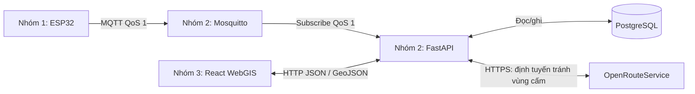

# Phân công công việc — Hệ thống IoT cảnh báo ngập và đề xuất lộ trình

**Phạm vi:** MVP, triển khai theo `KIEN_TRUC_TONG_QUAN.md`.
**Công nghệ đã chốt:** Python FastAPI, PostgreSQL, React + TypeScript + Vite, Leaflet và MQTT QoS 1.
**Mô hình triển khai:** broker, backend, database và frontend chạy trên một laptop; ESP32 kết nối cùng mạng Wi-Fi. Bản đồ nền và OpenRouteService cần Internet.

## 1. Tổng quan phân công

| Nhóm | Phạm vi chính | Giao tiếp với các phần khác |
|---|---|---|
| **1. Phần cứng + MQTT client** | Đọc cảm biến, cảnh báo tại chỗ, gửi số đo và trạng thái | Gửi MQTT tới Mosquitto do nhóm 2 thiết lập |
| **2. Broker + backend + database + ORS** | Thu nhận, lưu dữ liệu, phân loại ngập, sinh vùng cấm và định tuyến | Nhận MQTT từ nhóm 1; cung cấp HTTP API cho nhóm 3; gọi ORS |
| **3. Frontend WebGIS** | Bản đồ, trạng thái trạm, vùng ngập, chọn điểm và hiển thị tuyến | Gọi HTTP API của nhóm 2; không gọi ORS trực tiếp |



## 2. Nhóm 1 — Phần cứng và MQTT client

### 2.1. Công việc

- Đấu nối ESP32, cảm biến HY-SRF05, LED và còi; kiểm tra mức điện áp tín hiệu phù hợp với ESP32.
- Đọc khoảng cách, hiệu chuẩn mốc `H0`, quy đổi thành độ sâu nước và đối chiếu bằng thước.
- Cảnh báo tại chỗ: dưới 10 cm xanh; từ 10 đến 20 cm vàng; trên 20 cm đỏ và còi.
- Kết nối Wi-Fi, kết nối broker và gửi telemetry mỗi 1–3 giây.
- Tự kết nối lại khi mất mạng; không để lỗi mạng làm dừng việc đo và cảnh báo.
- Phát hiện phép đo lỗi; không gửi số đo lỗi dưới dạng mực nước 0 cm.
- Gửi trạng thái online, cấu hình Last Will báo offline.
- Tạo số thứ tự bản tin và mã phiên khởi động để backend chống trùng.

### 2.2. Công nghệ đề xuất

| Thành phần | Đề xuất |
|---|---|
| Phần cứng | ESP32 + HY-SRF05 + LED/buzzer |
| Firmware | C++ với Arduino framework |
| Môi trường phát triển | Arduino IDE **hoặc** VS Code + PlatformIO, tùy nhóm phần cứng lựa chọn |
| MQTT client | Thư viện hỗ trợ **publish QoS 1**, ví dụ `espMqttClient`; xác minh tương thích với board/framework trước khi chốt |
| Kiểm thử | Serial Monitor và MQTT client trên laptop |

Arduino IDE phù hợp nếu nhóm mới bắt đầu hoặc đã quen công cụ Arduino. VS Code + PlatformIO thuận tiện hơn khi quản lý nhiều file, thư viện và chia sẻ cấu hình dự án. Cả hai đều có thể dùng Arduino framework để lập trình ESP32; không bắt buộc dùng PlatformIO.

**Lưu ý:** PubSubClient thông dụng chỉ hỗ trợ publish QoS 0, nên không đáp ứng yêu cầu publish QoS 1 của tài liệu. Không nhầm hỗ trợ subscribe QoS 1 với publish QoS 1.

### 2.3. Giao tiếp với nhóm 2

Nhóm 2 cung cấp IP broker, cổng, tài khoản, quyền topic và cấu hình kết nối. ESP32 dùng IP LAN của laptop, **không dùng `localhost`**.

| Topic | Nội dung | QoS | Retain |
|---|---|---|---|
| `flood/{deviceId}/telemetry` | Số đo cảm biến | 1 | Không |
| `flood/{deviceId}/status` | Online/offline; Last Will offline | 1 | Có |

Payload telemetry mẫu:

```json
{
  "device_id": "station-01",
  "boot_id": "boot-001",
  "seq": 125,
  "measured_at": "2026-11-07T08:30:00Z",
  "water_depth_cm": 15.2,
  "sensor_ok": true
}
```

- `device_id`: mã trạm cố định, trùng với mã trong topic.
- `boot_id`: mã mới mỗi lần khởi động; ví dụ trên chỉ để minh họa, không được dùng cố định trong firmware.
- `seq`: tăng dần trong một phiên khởi động.
- `measured_at`: UTC khi thiết bị đã đồng bộ giờ; dùng `null` nếu chưa có thời gian hợp lệ.
- `water_depth_cm`: đơn vị cm; dùng `null` khi phép đo lỗi và đặt `sensor_ok = false`.
- Backend lưu thêm `received_at`; hai nhóm thống nhất cách xử lý dữ liệu chưa đồng bộ giờ.

Payload status tối thiểu:

```json
{
  "device_id": "station-01",
  "status": "online"
}
```

Last Will dùng cùng cấu trúc với `status = "offline"`. Trạng thái online không thay thế việc kiểm tra độ mới của số đo.

### 2.4. Bàn giao và nghiệm thu

- Sơ đồ đấu nối, danh sách linh kiện, firmware và hướng dẫn cấu hình/hiệu chuẩn.
- Demo gửi dữ liệu tới broker của nhóm 2, bao gồm phép đo hợp lệ và lỗi cảm biến.
- LED/còi đúng ngưỡng ngay cả khi mất server.
- Thiết bị kết nối lại được sau khi mất mạng; khởi động lại không làm backend nhầm bản tin mới là bản tin cũ.

## 3. Nhóm 2 — Mosquitto, FastAPI, PostgreSQL và ORS

### 3.1. Công việc

**Hạ tầng**

- Thiết lập Mosquitto và PostgreSQL; có thể dùng Docker Compose nếu nhóm quen Docker.
- Cấu hình broker lắng nghe trên giao diện LAN phù hợp, firewall, tài khoản và quyền topic.
- Dùng mạng LAN tin cậy cho MVP; không mở broker/database công khai ra Internet.
- Quản lý cấu hình bằng biến môi trường và cung cấp `.env.example` không chứa bí mật thật.
- Hướng dẫn cách khởi chạy và xác định IP laptop.

**Thu nhận và lưu dữ liệu**

- Subscribe `flood/+/telemetry` và `flood/+/status` với QoS 1.
- Kiểm tra schema, mã trạm, đơn vị, giá trị và thời gian bản tin.
- Chống trùng bằng khóa `device_id + boot_id + seq`, có ràng buộc duy nhất ở database.
- Lưu số đo hợp lệ và cờ chất lượng; bản tin sai schema phải được ghi log để điều tra.
- Phân loại ngập theo cùng ngưỡng với thiết bị.
- Tách `hazard_state` khỏi `data_quality`: mất dữ liệu không có nghĩa hết ngập.
- Kiểm tra thời gian từ số đo cuối, không chỉ dựa vào status MQTT.
- Không để bản tin cũ đến muộn ghi đè trạng thái mới hơn.

**Định tuyến**

- Lấy cấu hình vị trí và các trạm đang nguy hiểm; sinh vùng cấm bán kính thử nghiệm khoảng 40 m, có thể cấu hình.
- Chuyển vùng cấm thành đa giác GeoJSON để gửi trong `avoid_polygons`.
- Gọi OpenRouteService khi người dùng yêu cầu tìm đường.
- Kiểm tra tuyến trả về có giao vùng cấm hay không; giới hạn số lần thử lại nếu tăng bán kính.
- Không tìm được tuyến phù hợp hoặc dữ liệu không đủ thì trả lý do rõ ràng; không dùng tuyến mặc định chưa kiểm tra.
- Giữ khóa ORS ở backend; đặt timeout và xử lý lỗi/hết hạn mức API.

### 3.2. Công nghệ đề xuất

| Thành phần | Đề xuất |
|---|---|
| API server | Python + FastAPI + Uvicorn |
| Kiểm tra dữ liệu | Pydantic |
| MQTT client | paho-mqtt |
| Database | PostgreSQL |
| Truy cập DB / migration | SQLAlchemy + Alembic |
| HTTP client gọi ORS | httpx |
| Hình học | Shapely + pyproj |
| Kiểm thử | pytest và MQTT publisher mô phỏng |

Shapely xử lý hình học phẳng; khi tạo buffer theo mét từ kinh/vĩ độ phải chuyển sang hệ tọa độ phù hợp rồi chuyển lại. Không cộng trực tiếp mét vào tọa độ địa lý.

MVP giữ một backend, chưa cần microservice. Trước mắt chạy **một Uvicorn worker**, quản lý vòng đời MQTT client rõ ràng để tránh mỗi worker khởi tạo một subscriber riêng.

### 3.3. Database tối thiểu

| Bảng | Dữ liệu chính |
|---|---|
| `stations` | Mã trạm, tên, tọa độ, hiệu chuẩn, ngưỡng cảnh báo, bán kính vùng cấm |
| `measurements` | Trạm, boot ID, seq, thời gian đo/nhận, độ sâu, chất lượng phép đo |

Trạng thái hiện tại có thể suy ra từ dữ liệu mới nhất; chỉ bổ sung bảng trạng thái riêng khi cần. Chưa cần PostGIS trong MVP.

### 3.4. Giao tiếp với nhóm 1

- Cung cấp broker, tài khoản thử nghiệm và hợp đồng MQTT ở mục 2.3.
- Cùng kiểm thử trường hợp mất mạng, khởi động lại, bản tin trùng và phép đo lỗi.
- Có publisher giả lập để kiểm thử mà không cần chờ phần cứng.

**Giới hạn QoS 1:** xác nhận MQTT theo từng chặng không đồng nghĩa số đo đã được lưu vào PostgreSQL. QoS 1 có thể giao trùng; cũng không tự lưu bù mọi số đo phát sinh khi ESP32 mất Wi-Fi. Nếu cần bảo đảm lưu bền/gửi bù, phải thiết kế thêm cơ chế riêng.

### 3.5. Giao tiếp với nhóm 3

| Endpoint | Chức năng |
|---|---|
| `GET /api/health` | Kiểm tra tình trạng backend |
| `GET /api/flood-zones` | Danh sách trạng thái trạm và vùng cấm hiện tại |
| `POST /api/routes/safe` | Yêu cầu tuyến tránh vùng ngập |

Hợp đồng dự kiến cho `GET /api/flood-zones`:

- `generated_at`: thời điểm backend tạo response.
- `stations`: mã trạm, vị trí, độ sâu mới nhất, thời điểm đo/nhận, mức ngập và chất lượng dữ liệu.
- `flood_zones`: GeoJSON FeatureCollection chứa các vùng cấm được backend xác định.
- Quy ước `hazard_state`: `normal`, `warning`, `danger`, `unknown`.
- Quy ước `data_quality`: `fresh`, `stale`, `invalid`, `missing`.
- Backend quyết định các trạng thái và vùng cấm; frontend chỉ hiển thị, không tự suy luận vùng an toàn từ việc thiếu dữ liệu.

Request tìm đường:

```json
{
  "start": { "longitude": 106.7001, "latitude": 10.7701 },
  "end": { "longitude": 106.7201, "latitude": 10.7901 }
}
```

Response thành công phải có tuyến GeoJSON, khoảng cách theo mét, thời gian dự kiến theo giây, thời điểm tính và cảnh báo về dữ liệu sử dụng. Tên `/safe` không phải cam kết an toàn tuyệt đối.

Response lỗi dùng mã ổn định trong `error.code` và thông báo trong `error.message`, phân biệt ít nhất:

- `INVALID_INPUT`: tọa độ/request không hợp lệ.
- `INSUFFICIENT_DATA`: không đủ dữ liệu để đề xuất.
- `NO_SUITABLE_ROUTE`: không tìm được tuyến phù hợp.
- `ROUTING_UNAVAILABLE`: ORS lỗi, timeout hoặc hết hạn mức.

Nhóm 2 và 3 chốt HTTP status tương ứng, schema chi tiết và JSON mẫu trước khi tích hợp; chuẩn hóa cả lỗi validation của FastAPI nếu dùng envelope lỗi chung. Dùng OpenAPI/Swagger làm tài liệu API chính thức. Khi chạy Vite và FastAPI khác origin, backend cấu hình CORS cho đúng origin frontend.

### 3.6. Bàn giao và nghiệm thu

- Broker, backend, database, migration và hướng dẫn chạy.
- Tài liệu API, cấu hình mẫu và dữ liệu giả lập.
- Bản tin hợp lệ được lưu; bản tin trùng không tạo bản ghi trùng.
- Mất dữ liệu không bị hiển thị hay xử lý như một xác nhận an toàn.
- Tuyến trả về đã được kiểm tra vùng cấm; lỗi ORS không dẫn đến trả tuyến chưa kiểm tra.

## 4. Nhóm 3 — Frontend WebGIS

### 4.1. Công việc

- Xây dựng bản đồ, bảng thông tin và chú giải màu.
- Hiển thị marker trạm, độ sâu, thời điểm cập nhật và vùng cấm.
- Phân biệt mức ngập với chất lượng dữ liệu; trạm mất dữ liệu hiển thị xám/không rõ, không tự đổi sang xanh.
- Cho người dùng chọn điểm đi và điểm đến trên bản đồ.
- Gửi yêu cầu tìm đường khi bấm nút; vẽ tuyến, khoảng cách và thời gian backend trả về.
- Hiển thị loading, lỗi API, mất kết nối và trường hợp không thể đề xuất.
- Thiết kế responsive để dùng trên laptop và điện thoại.

### 4.2. Công nghệ đề xuất

| Thành phần | Đề xuất |
|---|---|
| Giao diện | React + TypeScript + Vite |
| Bản đồ | Leaflet + React Leaflet |
| Gọi API | fetch + custom hook |
| CSS | Tailwind CSS nếu nhóm muốn dùng |
| State | State/hook React; chưa cần Redux hoặc TanStack Query |

Leaflet là thư viện hiển thị, không phải nhà cung cấp bản đồ nền. Chọn nguồn tile phù hợp, giữ attribution và tuân thủ chính sách sử dụng; không mặc định tải tile hàng loạt để dùng offline.

### 4.3. Giao tiếp với nhóm 2

- Poll `GET /api/flood-zones` mỗi 3–5 giây.
- Chỉ gọi `POST /api/routes/safe` khi người dùng yêu cầu.
- Tách module gọi API khỏi component, cấu hình URL backend qua biến môi trường.
- Dọn timer và hủy request khi component bị gỡ; tránh request polling chồng nhau.
- Khi request lỗi, có thể giữ dữ liệu cũ nhưng phải gắn nhãn không còn cập nhật.
- Khi dữ liệu vùng ngập thay đổi hoặc quá hạn, cảnh báo tuyến đang hiển thị có thể lỗi thời và cho người dùng tính lại; không tự gọi ORS theo mỗi lần polling.
- Không gọi trực tiếp MQTT, PostgreSQL hoặc ORS; không giữ khóa ORS trong frontend.

Nhóm 3 dùng mock JSON theo hợp đồng với nhóm 2 để làm giao diện trước khi backend hoàn tất. Nhóm 3 có thể hỗ trợ nghiên cứu response ORS và kiểm thử GeoJSON, nhưng phần tích hợp ORS thực tế vẫn nằm ở nhóm 2.

### 4.4. Bàn giao và nghiệm thu

- Giao diện, module API, mock JSON và hướng dẫn chạy.
- Hiển thị đúng marker, trạng thái, vùng cấm và tuyến từ backend.
- Không nhầm thứ tự tọa độ hoặc tự tính lại mức ngập theo luật khác backend.
- Có trạng thái loading/lỗi/dữ liệu cũ và thông báo khi không có tuyến phù hợp.
- Không dùng nội dung khẳng định tuyến “an toàn tuyệt đối”.

## 5. Hợp đồng chung phải chốt trước khi tích hợp

| Nội dung | Quy ước |
|---|---|
| Mã trạm | Thống nhất giữa firmware, MQTT và database |
| Mực nước | cm; phép đo lỗi là `null`, không phải 0 |
| Khoảng cách/bán kính | m |
| Thời gian di chuyển | giây |
| Timestamp | ISO 8601, UTC; backend lưu thêm thời điểm nhận |
| GeoJSON | `[kinh độ, vĩ độ]` |
| Leaflet | Nhiều API dùng `[vĩ độ, kinh độ]`; chuyển đổi tại lớp hiển thị |
| Ngưỡng ngập | Xanh `< 10`, vàng `10–20`, đỏ `> 20` cm |
| Telemetry | Mỗi 1–3 giây; QoS 1; không retain |
| Polling frontend | Mỗi 3–5 giây |
| Dữ liệu quá hạn | Đề xuất 15 giây không có phép đo hợp lệ thì `stale`; kiểm chứng và điều chỉnh sau thử nghiệm |
| ORS | Backend giữ khóa và quyết định vùng cấm/tuyến hợp lệ |

Ngưỡng quá hạn là cấu hình thử nghiệm, không phải tiêu chuẩn an toàn. Nếu trạm mất dữ liệu, không tự xóa cảnh báo cũ rồi coi khu vực an toàn. Nhóm 2 cần chốt chính sách bảo thủ về giữ vùng cấm hoặc từ chối đề xuất khi dữ liệu liên quan không đủ; nhóm 3 thể hiện đúng lý do backend trả về.

Nhóm 2 tổng hợp hợp đồng; nhóm 1 và 3 cùng xác nhận. Thay đổi schema phải thông báo và cập nhật JSON mẫu/OpenAPI trước khi tích hợp.

## 6. Các mốc triển khai

### Mốc 1 — Chốt giao tiếp

- Chốt mã trạm, MQTT payload, QoS, đơn vị, timestamp và ngưỡng quá hạn.
- Chốt schema API, lỗi và GeoJSON; chuẩn bị dữ liệu mẫu.
- Chốt IP/cổng và cách chạy môi trường thử nghiệm.

**Đầu ra:** cả ba nhóm có thể làm độc lập bằng dữ liệu mẫu cùng cấu trúc.

### Mốc 2 — Phát triển độc lập

- Nhóm 1: cảm biến, cảnh báo và MQTT trên broker thử nghiệm.
- Nhóm 2: publisher mô phỏng, lưu DB, API và gọi ORS.
- Nhóm 3: giao diện và bản đồ dùng mock JSON.

**Đầu ra:** mỗi nhóm demo được phần của mình mà chưa cần toàn bộ hệ thống.

### Mốc 3 — Tích hợp dữ liệu thật

- Nối ESP32 → Mosquitto → FastAPI → PostgreSQL.
- Frontend chuyển từ mock sang API thật.
- Kiểm tra các mức ngập, trùng bản tin, cảm biến lỗi và mất kết nối.

**Đầu ra:** mực nước và chất lượng dữ liệu thật hiển thị đúng trên bản đồ.

### Mốc 4 — Tích hợp định tuyến

- Frontend chọn A/B và gọi backend.
- Backend lấy vùng cấm, gọi ORS và kiểm tra tuyến.
- Frontend vẽ tuyến hoặc hiển thị lý do không thể đề xuất.

**Đầu ra:** luồng tìm đường hoàn chỉnh, không có tuyến mặc định chưa kiểm tra.

### Mốc 5 — Kiểm thử và chuẩn bị demo

| Kịch bản | Nhóm phối hợp | Kết quả mong đợi |
|---|---|---|
| Mực nước lần lượt xanh/vàng/đỏ | 1 + 2 + 3 | Đèn/còi và giao diện đúng ngưỡng |
| ESP32 mất Wi-Fi rồi kết nối lại | 1 + 2 + 3 | Cảnh báo tại chỗ vẫn chạy; web đánh dấu dữ liệu cũ |
| ESP32 khởi động lại | 1 + 2 | Boot ID mới; seq mới không bị loại nhầm |
| Bản tin trùng | 1 + 2 | Không tạo bản ghi số đo trùng |
| Cảm biến lỗi | 1 + 2 + 3 | Không bị diễn giải thành 0 cm/an toàn |
| Broker/backend ngừng chạy | 2 + 3 | Web báo mất cập nhật, không chuyển xanh |
| ORS timeout/hết hạn mức | 2 + 3 | Báo lỗi rõ ràng, không trả tuyến chưa kiểm tra |
| Không có tuyến tránh vùng cấm | 2 + 3 | Thông báo không thể đề xuất |
| Dữ liệu đổi sau khi đã vẽ tuyến | 2 + 3 | Cảnh báo tuyến có thể lỗi thời, cho phép tính lại |

## 7. Ngoài phạm vi MVP và lưu ý nhân lực

- AI/ML, dự báo 10–30 phút, biểu đồ nâng cao và PostGIS dành cho giai đoạn sau.
- Chưa cần Next.js, WebSocket, microservice hoặc ứng dụng di động riêng.
- **Nhóm 2 có khối lượng lớn nhất.** Nếu nhân lực ngang nhau, nhóm 3 hỗ trợ chuẩn bị GeoJSON mẫu, kiểm thử API và kịch bản ORS; không chuyển khóa API hoặc quyết định định tuyến sang trình duyệt.
- Bán kính vùng cấm là giả định thử nghiệm, không đại diện chắc chắn cho phạm vi ngập thực tế.
- Kết quả là tuyến **ít rủi ro hơn theo dữ liệu hiện có**, không phải chứng nhận an toàn ngoài thực tế.
